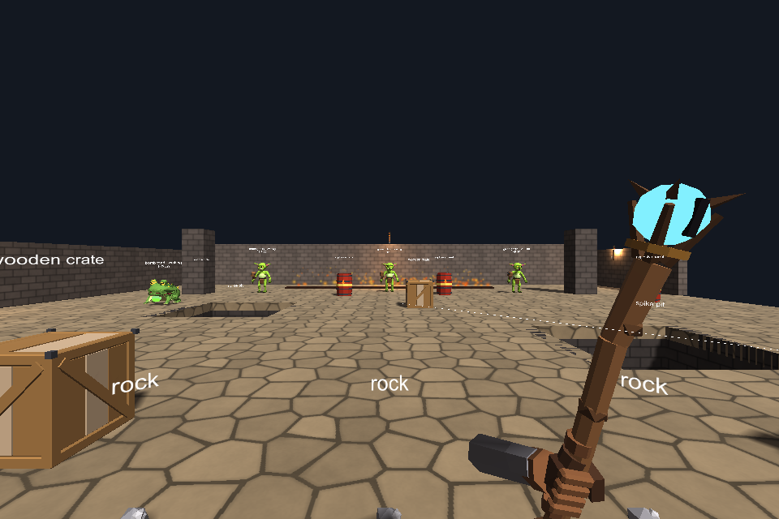
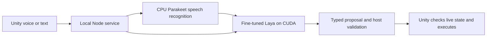

# Local Action Engine

[](https://github.com/CHL-work/local-action-engine/actions/workflows/ci.yml)

Voice and text become typed, validated game actions through local AI. This
repository contains the working Unity Windows prototype extracted from Project
Brainwash, its fine-tuned Laya integration, and selected training research.

The demo keeps its five scenarios, test room, arena, generated models, and sound
effects. Original `Brainwash` namespaces and model vocabulary are retained for
compatibility. The broader game's story, design archive, character documents,
and private training records are outside this repository.





## Run the Windows demo

1. Download the complete Windows ZIP from [Releases](https://github.com/CHL-work/local-action-engine/releases) and extract it to a writable folder. A GitHub **Source code** ZIP does not contain a built Player.
2. Install **Node.js 22.13+** and **Python 3.12 x64**. Live inference needs an NVIDIA CUDA GPU with at least **8 GiB free GPU memory** before loading; there is currently no CPU Laya fallback.
3. Open **Setup Demo.cmd**. Setup installs isolated Python environments and fetches the original checkpoint and pinned speech model, verifying their hashes. The initial downloads and installation use several GB.
4. Open **Play Demo.cmd**, wait for the service to become ready, then try the classic test room: meet a creature's eyes, hold **B**, say “Dance”, and release.
5. Open **Stop Demo.cmd** when finished to release the persistent model workers.

The Unity Editor and a Unity license are build-time requirements only. Running
the packaged Player does not require them. Its menu/gallery can be opened
directly from `unity/Builds/Windows/BrainwashSandbox.exe` without models; voice
and typed-command interpretation need the local AI service.

See [Windows setup](docs/windows-setup.md) for prerequisites and troubleshooting,
and [the demo guide](docs/demo.md) for scenarios, controls, and diagnostics.

## Engineering demonstrated

- **Local model integration:** persistent Python workers, bounded JSONL transport,
  pinned checkpoints, CPU speech recognition and CUDA classification.
- **Application correctness:** validated typed actions, per-actor world snapshots,
  dependent references, leases, cancellation, deadlines and stale-result rejection.
- **Game systems:** Unity/C# perception, input ownership, physics, navigation,
  inventory, procedural animation and action execution.
- **Fine-tuning research:** command-to-decision compilation, split isolation,
  provenance, resumable training, compute accounting and model selection.
- **Delivery:** Windows/Linux offline CI, a licensed Windows Player build,
  scenario tests, explicit release file lists and checksums.

The original English checkpoint recorded **430/450 final-order agreement** against
synthetic validation labels. This is not measured human player-intent accuracy
or Unity task success rate. [Training case study](docs/training.md) ·
[Model card](docs/model-card.md).

## Develop and test

```powershell
npm ci --ignore-scripts
npm test
python -m unittest discover -s tools -p "test_*.py"
python -m unittest discover -s prototype -p "test_*.py"
python -m unittest discover -s research/training -p "test_*.py"
python -m unittest discover -s scripts -p "test_*.py"
```

These checks use fixtures and temporary fake weights. They do not load models,
train, call a hosted AI provider, or require a GPU.

Install Unity **6000.3.26f1** with Windows Mono support and an eligible license:

```powershell
./unity/build.ps1 -UnityPath 'C:\Program Files\Unity\Hub\Editor\6000.3.26f1\Editor\Unity.exe'
./scripts/test-windows-demo.ps1
```

[CI and release guide](docs/windows-ci.md) describes Actions secrets, tagged
releases, test evidence, and packaging. Hosted builds fail explicitly until
Unity activation secrets are configured.

## Source map

| Directory | Purpose |
| --- | --- |
| `prototype/` | Local HTTP service, persistent workers, STT setup and tests |
| `training/` | Classifier questions, contracts, decoding and dataset preparation |
| `eval/` | Action registry and deterministic host compiler |
| `unity/` | Existing Windows demo source, assets and C# probes |
| `research/training/` | Archived trainer, offline tests and historical results |
| `models/` | Download identity and hashes; weights stay outside Git |
| `art/` | Scripts reproducing models and synthesized effects |
| `scripts/` | Release packaging and packaged-game acceptance |
| `provenance/` | Source identities and extraction boundary |

The runtime uses local models after setup, with no hosted inference API key.
Kubernetes, multiplayer, CPU Laya inference, and broad hardware/language
performance claims are outside this release.

## License

Original code and generated demo assets: [Apache-2.0](LICENSE).
Models, Unity and installed dependencies retain their respective terms; see
[NOTICE](NOTICE) and [third-party notices](THIRD_PARTY_NOTICES.md).
